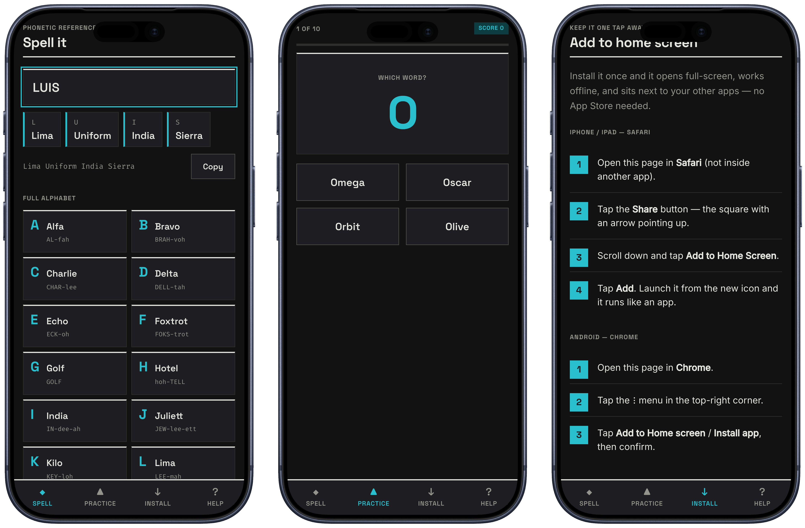

# LinkedIn — NATO Alphabet

Document title: Spell it on the call
File: NATO Alphabet — LinkedIn (Paper)
Size: 1080 × 1350, 7 pages, PDF
URL: https://thehoomanloop.com/spell

## Framed screenshots

iPhone 17 Pro (Deep Blue) mockups, framed with the [Apple Frames CLI](https://github.com/viticci/frames-cli). Source captures live in [`screenshots/`](screenshots/); framed finals in [`framed/`](framed/).

- Spell: [`framed/spell_framed.png`](framed/spell_framed.png)
- Practice: [`framed/practice_framed.png`](framed/practice_framed.png)
- Install: [`framed/install_framed.png`](framed/install_framed.png)
- Three-up strip: [`framed/merged_framed.png`](framed/merged_framed.png)

To re-shoot: `node /tmp/nato-shots/capture.mjs` (Playwright, iPhone 17 Pro Portrait), then `frames -c "Deep Blue" -o framed/ screenshots/*.png` and `frames -m -s 80 -c "Deep Blue" -o framed/ screenshots/*.png`.

## Caption

I kept fumbling names on calls.

Bad connection. Someone asks you to spell it. You blank on W.

So I built a tiny tool I can open mid-call: type a name, get the NATO words, glance the full A–Z. Plus a 10-prompt practice game so it actually sticks.

It is a website you add to your iPhone home screen. Works offline. No App Store.

https://thehoomanloop.com/spell

Swipe for how it works.

#BuildInPublic #PWA #ProductDesign

## First comment

Try it here — add it to your home screen from Safari:

https://thehoomanloop.com/spell/install

## Publish

1. Export the 7 artboards as one PDF from Paper (or use the export in this file).
2. LinkedIn → Start a post → More → Add a document.
3. Title: Spell it on the call
4. Paste the caption.
5. Post from your personal profile.
6. Add the first comment with the install URL.
